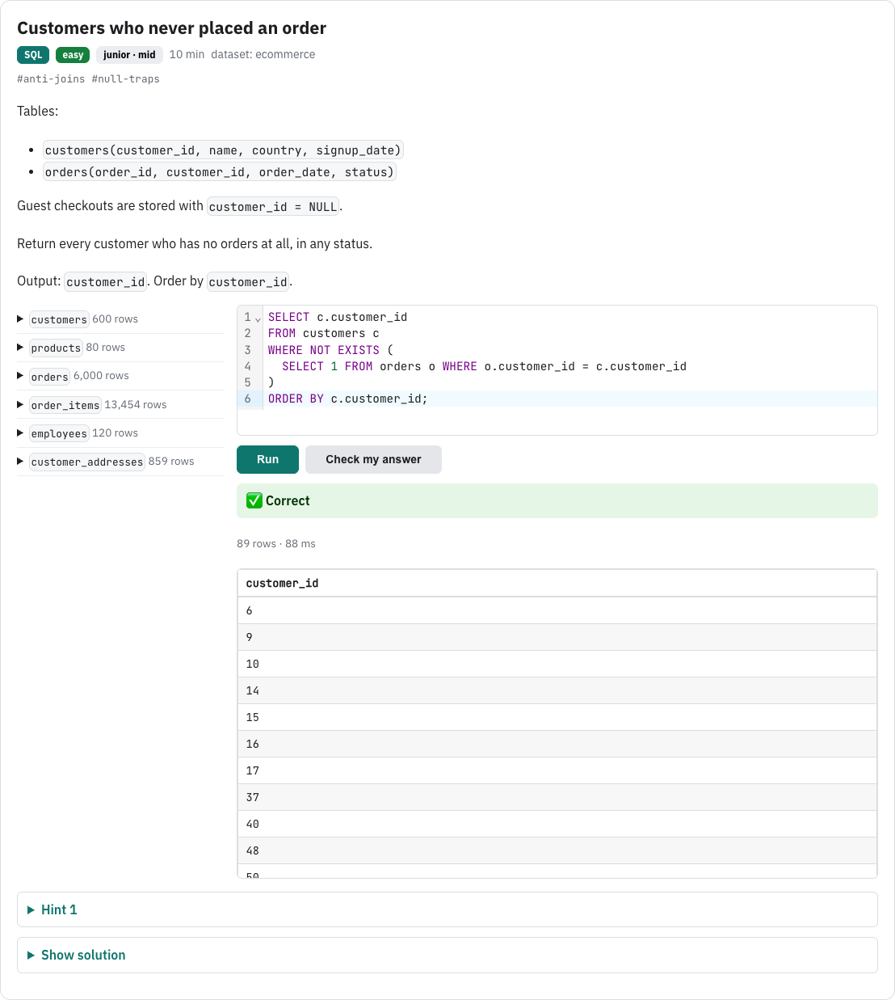
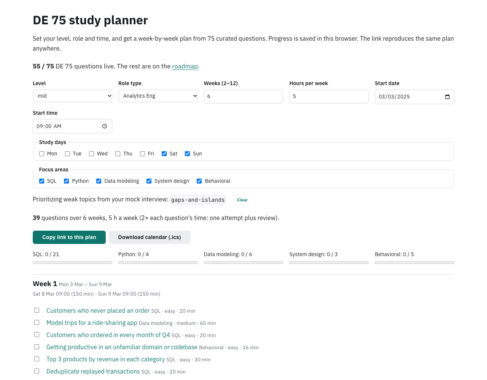
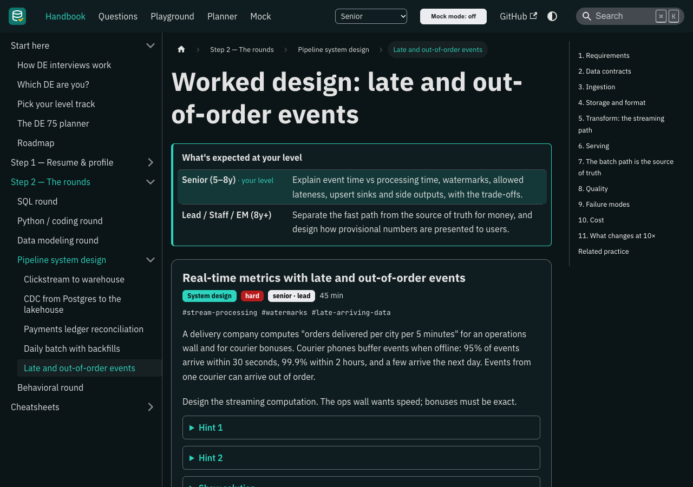

# Data Engineering Interview Handbook

A free, open-source **practice** handbook for data engineering interviews, with level tracks from Junior to Lead/Staff & EM.

**→ [jagadeshjamjala.github.io/de-interview-handbook](https://jagadeshjamjala.github.io/de-interview-handbook/)**

- **75 practice questions:** 30 SQL, 10 data modeling, 10 Python, 10 pipeline system design (with worked designs), 10 tools, 5 behavioral. Each has hints, a model answer and a weighted rubric.
- **SQL playground:** solve SQL questions in your browser on realistic datasets (DuckDB-WASM) and get an instant ✅/❌ against the reference answer. Nothing leaves your browser.
- **DE 75 study planner:** a week-by-week plan for your level, role type and time, with progress tracking, a shareable link and a calendar export.
- **Mock interviews:** timed, spoiler-free sessions with rubric self-scoring. The debrief feeds your weak topics back into the planner.
- **Level tracks everywhere:** pick your level and every page highlights what's expected from you.

| Solve SQL in the browser | Plan your weeks | Worked designs, by level |
|---|---|---|
|  |  |  |

Every SQL answer is checked in CI against a reviewed expected result, and every Python answer against its tests, so a wrong answer can't be merged.

## How to contribute a question

1. **Set up.** Fork and clone, then `corepack enable pnpm && pnpm install`. For SQL or Python questions, also `python -m venv .venv && .venv/bin/pip install -r requirements.txt`.
2. **Write the YAML.** Copy a similar file in `questions/<round>/` to `questions/<round>/<your-id>.yaml`. The `id` must match the file name. Fill in `levels`, `topic`, `prompt`, `hints`, `solution` and a `rubric` (see [`schemas/question.schema.json`](schemas/question.schema.json)). Only add a company tag with a public source link.
3. **Prove the answer.**
   - **SQL:** pick a `dataset` and run `.venv/bin/python scripts/verify_sql.py --update-golden`, then read the new `questions/sql/expected/<id>.csv` and confirm it's right.
   - **Python:** add `tests` (plain asserts) and run `.venv/bin/python scripts/verify_python.py`.
4. **Check it.** `pnpm questions` validates every question and page. `pnpm dev` shows your question at `/questions`.
5. **Open a pull request.** Say where the question comes from and what it tests. CI runs every check.

Found a wrong answer instead? Open a [Fix an answer](https://github.com/jagadeshjamjala/de-interview-handbook/issues/new?template=fix-answer.yml) issue. More in [CONTRIBUTING.md](CONTRIBUTING.md).

## Run locally

Requires Node 20+ (24 recommended) and pnpm via corepack.

```bash
corepack enable pnpm
pnpm install
pnpm dev          # http://localhost:3000/de-interview-handbook/
```

Other scripts: `pnpm build`, `pnpm test`, `pnpm typecheck`, `pnpm lint`, `pnpm format:check`, `pnpm questions`. The plan and decisions behind the project are in [PLAN.md](PLAN.md).

## License

This repo has two licenses:

- **Code** (site, components, scripts): [MIT](LICENSE).
- **Content** (`apps/website/docs/`, `apps/website/blog/`, `questions/`): [CC BY-SA 4.0](LICENSE-CONTENT). You may reuse and adapt it, commercially too, as long as you credit this project and share your version under the same license.

## Credit

The handbook's structure is inspired by the [Tech Interview Handbook](https://github.com/yangshun/tech-interview-handbook). All content here is original. No text is copied from it.
